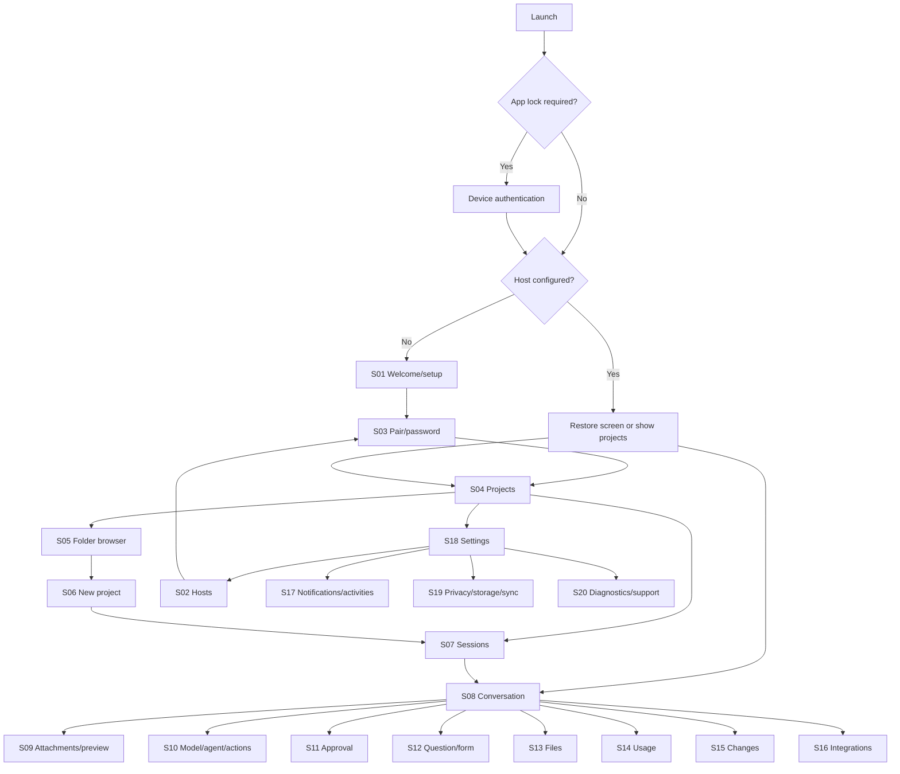

# Native navigation and screen specification

## Interaction reference and identity

Use the conversation-led pattern of ChatGPT/Codex: quick access to previous chats/projects, a persistent composer, clear activity, attachments beside the draft, and review controls reachable without leaving the conversation. OpenAI's [mobile remote-work guide](https://learn.chatgpt.com/blog/mastering-codex-remote-for-engineering) describes starting, steering, reviewing, and organising work from a phone. Its [projects/chats documentation](https://learn.chatgpt.com/docs/projects?surface=app) supports the project-to-conversation organisation reference. These are interaction references, not permission to copy branding/assets or a claim that our screens match an exact current app build.

OpenCode supplies the functional model: host connection, actual project directory, sessions, inbox, agent/model, pending forms/permissions, tool activity, file tree and review panel. A project here is a host filesystem location, not a ChatGPT shared cloud-context container. Use original product branding and SF Symbols where appropriate.

## Navigation architecture

On iPhone, keep Projects, Sessions, and Settings as native tab roots, each with its own NavigationStack. Push Conversation from either Projects → Sessions or the global Sessions root; preserve the origin on Back. Inside a conversation, leading navigation opens the project/session browser, while trailing Files/Changes buttons open full-height native inspector sheets with expandable content. New Session is one tap from the project/session browser and is also available in the conversation menu. Do not hide all engineering actions behind Settings.

On iPad, use NavigationSplitView: primary sidebar (host switcher, Projects, Sessions, Settings), content list (projects/sessions), and conversation detail. A trailing inspector shows Files, Changes, Usage, or Integrations. It can collapse when width is insufficient; use the iPhone sheet presentation in compact width. Multiple scenes have separate navigation and share session state. Open in New Window appears in project/session context menus.



Internal destinations are typed values carrying local `hostUUID`, optional project/directory, `sessionID`, and optional message/file/interaction selection. Do not put credentials in route strings, restoration state, notification payloads, or iCloud. Server IDs are scoped by host; two hosts can have the same session ID. Restoration/deep linking refetches current identity/access and never executes an action automatically.

## Shared layout and interaction rules

- Native navigation bars, searchable lists, sheets, context menus, confirmation dialogs, keyboard avoidance, swipe-back, Dynamic Type, VoiceOver, system appearance, and reduced-motion support are required, not later polish.
- Always show host/project identity near the session title, with an accessible status label. Use colour plus text/icon. Never let a stale title imply a different active project.
- Long-running operations show progress or a named phase. Keep Cancel/Stop visible where the underlying operation supports cancellation. A dismissed sheet does not silently cancel a server task or discard a draft.
- Opening files/inspectors must not interrupt execution or discard composer selection, reading position, or attachments. Navigating away does not Stop the session.
- Tool execution is presented through expandable cards, not invented assistant prose. “Thinking” means the host is executing or has supplied reasoning events; never show fabricated chain-of-thought or a progress percentage without a real denominator.
- All mutating controls show pending/success/error and use authoritative readback. Disable only the affected action, not the whole app. Uncertain outcomes enter Checking Result and reconciliation.
- Error messages identify next steps: Reconnect, Re-pair, Retry Read, Reload Latest, Reattach, Open Existing, or Share Diagnostics. Do not show raw implementation stacks in normal UI.

## Screen inventory and API bindings

Screen IDs are stable test identifiers, not on-screen labels. Workflow IDs refer to the [API contract](api-contract.md) and [scope manifest](../contracts/mobile-scope.json).

| ID  | Screen and presentation                             | Required content/actions                                                                                                                                         | Workflows         |
| --- | --------------------------------------------------- | ---------------------------------------------------------------------------------------------------------------------------------------------------------------- | ----------------- |
| S01 | Welcome and guided setup; native page sequence      | Explain own host/VPN, Add Host, demo mode, optional app lock/iCloud; ask alert categories/content and activity start preference            | W01, W16, W17     |
| S02 | Hosts; Settings list and reusable host-picker sheet | Name, reviewed address, connection/version/auth state; select, add, edit/re-pair, diagnostics, remove host                 | W01, W17          |
| S03 | Connect Host; sheet/page                            | Scan QR (primary), pairing-link field, optional display name, server-URL/username/password fallback, reviewed target(s), Connect/Cancel, health checks           | W01               |
| S04 | Projects root/sidebar content                       | Host picker, pinned/recent projects, searchable names/paths, canonical directory, Open Folder, New Project; project context menu and New Session                 | W02, W03          |
| S05 | Folder browser; sheet with breadcrumb/back          | Remote directories, parent navigation, type-safe selection, filename search, readable permission/network errors, Choose Folder/New Folder                        | W02               |
| S06 | New Project confirmation; sheet                     | Existing parent, validated folder name, resolved target/config path, optional display name, create/open-existing/conflict handling                               | W02, W03          |
| S07 | Sessions root/project list                          | Search title, host/project filters, running/needs-attention/unread markers, pinned/recent groups, New Session, rename/pin/follow/hide/delete actions             | W03               |
| S08 | Conversation; primary detail                        | Header, transcript, thinking/tool/retry states, pending interaction dock, inbox, attachment chips, Markdown composer/preview, model/agent, Send/Queue/Stop       | W03–W10, W13, W16 |
| S09 | Attachment tray and preview; native pickers/sheets  | Files/Photos/Camera, file size/type, original/balanced photo copy, location option, progress/cancel/retry/remove, missing/unsupported indicators                 | W08               |
| S10 | Model/agent/skills/commands picker; sheet           | Search, configured model variants/context/input capability, agent description, available commands/skills, selected and unavailable states                        | W06, W07          |
| S11 | Permission detail; dock + native sheet              | Requested action/resources, tool/source context, exact allow scope, Allow Once/Always if applicable/Reject, optional message                                     | W09               |
| S12 | Question/form; dock + native sheet/page             | Full title/description, typed fields/options/custom choices, validation/visibility rules, external browser links, submit/cancel, settled state                   | W10               |
| S13 | Files inspector and file preview                    | Tree/breadcrumb, filename search, source/Markdown/image/PDF viewer, text search, line navigation, copy/share, Attach to Draft                                    | W11, W08          |
| S14 | Usage/context inspector                             | Last-reported context, model limit/unknown, token categories, cumulative estimated cost, compaction state and Compact action                                     | W13               |
| S15 | Changes inspector and diff detail                   | Session-turn/workspace scope, selected range/base, changed file totals, unified/side-by-side diff, context expansion/search/change navigation/copy               | W12               |
| S16 | Integrations inspector                              | Plugin/MCP segmented list, scope/source/effective status, plugin toggle plan/readback, runtime MCP Connect/Disconnect, error/auth-required detail                | W14, W15          |
| S17 | Notifications and Live Activities                   | Category/privacy choices, following scope, permission status, activity-start preference/freshness, device test guidance | W16, W17          |
| S18 | Settings root                                       | Appearance, privacy/app lock, storage/drafts, attachments/network, iCloud, notifications/activities, diagnostics/support, licences/source/demo            | W17               |
| S19 | Privacy/storage/sync subpages                       | Actual local sizes, Clear Cache, draft expiry default/choices, backup explanation, app lock grace, iCloud status/opt-out/cloud-clear, Clear Local Data           | W17               |
| S20 | Diagnostics/support and licences                    | Redacted local logs/report preview/share/clear, host readiness checks, app/server versions, GitHub support/private security route, MPL/source/dependency notices | W17               |

## S01–S03: Setup, pairing, and recovery

Setup is useful with a missing/offline host: show instructions and allow editing/retrying, rather than stranding users at a spinner. The existing OpenCode pairing process is the default method; the app does not create its own host accounts. Provide copyable `opencode pair` instructions and the existing VPN-reachable URL option. QR scanning accepts only the existing payload; stop the camera after a valid scan, show reviewed destination(s), and redeem on user confirmation. Do not spend a code while generating a passive input preview.

Password fallback has a single server URL field (host with optional scheme, port, and proxy path prefix), a username prefilled with the fixed `opencode` value, optional display name, password and Connect. Do not autofill a credential into a changed origin without revalidation. Pairing states: idle → parsing/review → redeeming → health check → saved. Error variants are invalid/legacy link, expired/spent code, unreachable address, TLS trust failure, rejected credential, and unsupported server capability/version. After successful redemption followed by failed health, retry with the retained token. Removing a host is a separate confirmed flow describing local draft/credential effects and server-revocation limits.

Demo mode points at the mock transport/fixtures, visually labelled Demo, with no production credential or provider access. Production setup does not allow arbitrary HTTP/TLS bypass; mock HTTP is a development-only transport profile.

## S04–S07: Projects and sessions

Project rows show name, path and host, never only a friendly name when it could be ambiguous. Search filters the current known project inventory; opening an unlisted directory uses Folder Browser. Folder name validation rejects empty names, `.`/`..`, separators and control characters, then the server verifies the actual resolved target. Allow ordinary Unicode names. Creating a folder/config is shown as such; it is not advertised as repository cloning or a Git commit.

New Session opens a durable local unsent draft bound to the chosen host/location. The first Send creates the native session with a stable creation identity, then admits the prompt; once a session exists, subsequent sends do not create another. An optional “Create empty session” action uses the same create endpoint explicitly. If creation succeeds but submission fails, keep the new session and draft. Track these as separate outcomes.

Session search uses native server title search. Do not label it full transcript search: no verified full-text transcript search contract is selected. Project-filtered and all-host views must make their scope visible. Pinned/followed/hidden states are local to the device; separate them from server state. Hidden sessions appear under a reversible Hidden on This Device filter. Archive/Restore are unavailable in this pinned baseline and show a capability explanation, not a fabricated mutation.

Deletion asks for confirmation and child-session impact; removing an item from a list optimistically is not proof that server deletion succeeded. Retain a recoverable draft until reconciliation. Swipe actions have accessible menu equivalents.

## S08: Conversation composition and layout

```text
┌──────────────────────────────────────────┐
│ ‹ Sessions   Review changes       ⋯      │
│ Harbour Demo · demo-host  ● Connected    │
├──────────────────────────────────────────┤
│ You                                      │
│ Please review **this project**            │
│                                          │
│ Working · 00:12                          │
│ ▸ Thinking (server supplied)              │
│ ▾ read · src/main.py · Completed          │
│   Arguments / Output / Affected files     │
│ Rendered Markdown response…              │
│                                          │
│ [Files] [Changes 2] [Context 14%*]         │
├──────────────────────────────────────────┤
│ Approval required · Review request       │
│ Queued 1 · Review queue                   │
├──────────────────────────────────────────┤
│ [diagram.png ×]                          │
│ +  Message…                              │
│ Build · Demo Code ▾   Preview    Send ↑   │
└──────────────────────────────────────────┘
* Last reported; display unknown if unknown.
```

This wireframe specifies hierarchy and actions, not fixed pixel dimensions. On iPad, Files/Changes/Usage are in a persistent trailing inspector when space permits. On phone they open native sheets with their own navigation and a full-screen expansion action.

Transcript rendering uses one pipeline for both roles and composer preview. Support Markdown tables/lists/code, source view, selection/copy, diagrams/math via the selected narrow fallback where supported, and tap-to-load external images. Render local file/session links through typed internal navigation. Unknown message types remain discoverable with a generic item rather than being silently deleted from history. Tool outputs preserve raw/copyable content and expand/search controls; a collapsed long output has its real size/status and is never presented as complete truncated content.

The working indicator appears as soon as the server reports execution, before first text. Show phase labels Working, Thinking, Running `<tool>`, Waiting for Approval, Waiting for Answer, Retrying with next-attempt information, Stopping, Reconnecting, or Checking Result. Stop remains visible when execution is active. A transport failure adds an Offline/Reconnecting banner while retaining last-known execution with a stale timestamp; it does not show Completed. Elapsed time is display information, not proof that the host is still executing. Preserve the reader's position unless they are already following the bottom; offer Jump to Latest.

Composer behavior:

- Native multiline source editor, plus button for attachments/context, Markdown preview toggle, host-configured model/agent selector, and clear Send/Stop affordances. No voice button in initial scope.
- Idle: Send. Running: allow explicit Steer Now or Queue after Current, matching native delivery values; show admitted inbox items separately from unsent text. Stop is a distinct action.
- Sending with pending uploads waits visibly; it does not silently drop files or submit automatically after an interrupted attempt. Cancellation retains appropriate draft state.
- Disconnected: preserve text/attachments; Send remains unavailable with a clear connection reason. Reconnect never auto-sends.
- After admission, clear only the acknowledged draft. If outcome is uncertain, retain it with Checking Result and reconcile stable IDs; do not insert duplicate bubbles as retries.
- Two iPad windows: non-owner draft editors show Editing in Another Window with Edit Here. Explicit handoff flushes pending text, transfers ownership and focuses the new editor.

Pending approvals and questions appear above the composer, with a count/list if several exist. Show pending child-session requests as linked entries when attribution is available, preserving the actual owner IDs. The detail sheet remains usable with the keyboard and large text. Never send a notification-tap approval automatically.

## S09–S12: Attachments, selection, and interaction details

Attachment chips show file name/type/size and preparing/uploading/ready/failed/missing/unsupported state. Native previews support images/PDF/text where available. Original/Balanced photo options and location metadata choice show the final prepared size. The user can remove, cancel, retry or reattach one item independently. Unsupported model input offers a clearly labelled host-file/tool path where the web/server contract supports it; do not claim native model ingestion when only a tool can open the file.

The model/agent sheet has search, current selection, model variants and capability detail. Preserve the selection when navigating. Do not invent providers or Plan/Build agents absent from the host. Skills/commands can be searched through composer affordances and invoke the native operation; installing/managing providers/skills is outside this initial view.

Approval detail shows the exact command/resource/action and requested save scope before buttons. Default primary action is Allow Once; Always is a distinct action only where the host request supports a meaningful save scope. Reject and optional explanation remain visible. During submission disable the specific response buttons. If answered elsewhere, replace buttons with settled status and a Return to Chat action.

Question detail renders every defined field in order. Conditions update visibility and remove inactive answer values; required, bounds, formats and option constraints are reflected locally where supported. Multiselect uses independently selectable rows; boolean is a true/false control; numeric fields preserve typed values, not numeric strings. External fields open the default browser. Validation errors stay beside the field plus an accessible summary. Submission retains entered answers on failure; cancellation is explicit and a settled form does not become editable again.

## S13–S16: Workspace inspectors

Files preserves tree expansion and path while switching tabs/inspectors. Filename search and within-file text search are separate labelled controls. Read-only status is explicit; no Save/Edit control is exposed for deferred direct editing. Attach to Draft uses a remote reference and returns to the existing draft without sending. Large previews offer progressive Load More/Save, not a permanently truncated file. Symlinks/path errors and permission failures use the server's actual outcome.

Usage shows last report time, tokens by category, context limit/percentage when known, cumulative estimated cost, and compaction status. Compact is explicit; admission shows Queued/Running until native events/readback establish completion. Unknown pricing/context is shown as unknown, not zero. No agent todo panel is introduced.

Changes has a clear Session Turn / Workspace scope selector. Session Turn offers the relevant user-turn range; workspace shows branch/base. File rows display path/status/additions/deletions. Selecting a file opens its patch, preserving selected scope. Three context lines is default; changing context causes a native refetch, with full-file context only when supported. Side-by-side adapts to width. Binary/nontext changes show an accurate summary instead of a fake textual diff. A server error or unresolved base is not the same as No Changes.

Integrations shows Plugins / MCP segments. Every row separates configured intent, source/scope, effective runtime status, pending change and error. Project plugin toggles show a concise proposed configuration change and preserve unrelated JSONC; conflicts offer Reload or Reapply to Latest, with no blind overwrite. Protected plugins show why the control is unavailable. MCP buttons explicitly say Connect/Disconnect (runtime); authentication-required state links to currently supported host setup guidance. Persistent MCP add/remove/auth flows remain later scope.

## S17–S20: Preferences, notifications, and support

Use the exact controls/defaults in [implementation-defaults.md](implementation-defaults.md). Group settings by outcomes and keep advanced details collapsed. Before configuration, generic notification content is the safe default but no categories or automatic activities are assumed enabled. Show the user's choice alongside iOS permission status: these are separate states. Initial Live Activities show freshness and can become stale while the main app is suspended.

S17 presents NO delivery status: local push was removed (21 October 2026), so there is no manager/stream health, no received/relevant/scheduled counts, and no Retry Local Push to show — a row with no mechanism behind it must not exist.

Notification taps resolve local host UUID and server session/interaction IDs, authenticate if needed, refetch current pending state, and navigate to the relevant screen. If the host is unavailable, retain the destination with Retry; if the interaction settled elsewhere, show that state. No approval/reject action is exposed as a lock-screen mutation. Missing/removed hosts route to an explanatory connection screen.

Diagnostics shows only redacted local information by default. Export opens a preview before the system share sheet; no auto-upload or automatic GitHub issue creation. Distinguish public support from private security reporting. Licences/Source links identify the corresponding distributed release and MPL/dependency notices. Demo reset affects only generated demo state.

## Cross-screen state matrix

| State                    | Required presentation                                              | Permitted actions                                                    |
| ------------------------ | ------------------------------------------------------------------ | -------------------------------------------------------------------- |
| First load               | Native skeleton/progress with host identity; no invented data      | Navigate/cancel read where possible                                  |
| Empty                    | Specific explanation: no host/project/session/files/changes        | Relevant create/open/filter-reset action                             |
| Cached + refreshing      | Content plus Updating/last-updated indicator                       | Read/copy; writes only after host/session is verified                |
| Offline                  | Cached content with Offline/stale badge                            | Read/copy/edit local draft; reconnect; no queued auto-send           |
| Authentication expired   | Re-pair Required, affected host shown                              | Pair/password sheet; preserve drafts and destination                 |
| TLS failure              | Trust/setup guidance and exact host                                | Edit address/retry after trusted setup; no trust-all override        |
| Permission denied        | Explain camera/photos/iOS notification or server access separately | Relevant system settings or alternate picker/setup                   |
| Unsupported capability   | Explain baseline/version/feature limitation                        | Continue supported workflows; no success simulation                  |
| Pending mutation         | Action-level progress, stable draft/IDs                            | Cancel only if supported; no repeated submission                     |
| Uncertain result         | Checking Result with what is being checked                         | Reconcile; explicit recovery if still ambiguous                      |
| Conflict/already settled | Current authoritative result and retained local input              | Reload/reapply where valid; return to conversation                   |
| Large content            | Size plus progressive rendering/loading                            | Load More, search loaded scope, copy/save with accurate completeness |
| Recoverable read error   | Inline error, retained content if present                          | Retry Read and diagnostics                                           |
| Removed destination      | Explain missing host/project/session                               | Return to list; recover retained local draft text                    |

## UI test and restoration contract

Use stable accessibility IDs such as `S08.composer.send`, `S08.execution.stop`, `S11.permission.once`, `S12.form.submit`, `S15.scope`, and host/session-qualified row IDs. Never base test selectors on spinner animation or translated strings alone. Screen IDs/API bindings are verified by the scope manifest; UI tests must verify actual presentation once the Swift app exists.

Persist selected tab, scene route, inspector selection, history anchor, expanded tool items and draft identity. Restore only nonsecret identifiers; refetch permissions/forms/model options before exposing live controls. Restoring a cached conversation never runs its previous pending mutation. Process death, device backup restoration, window closure and host deletion are separate test cases.

The fixture/mock guide maps generated sessions and scenarios to these states. This document supplies the initial screen/behavior contract; exact typography/spacing should follow the selected native system components, then be verified with real-device accessibility and compact/regular-width snapshots.
